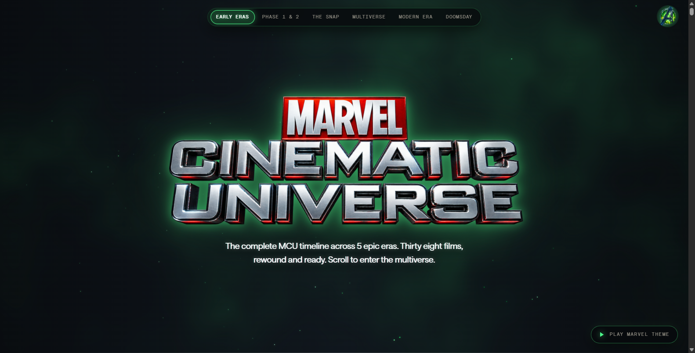
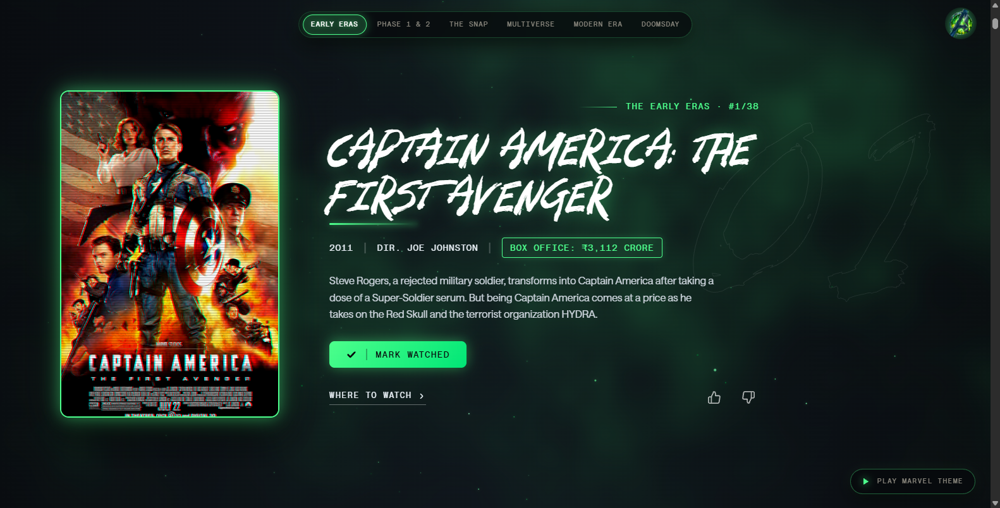

# 🎬 Marvel Cinematic Universe — Interactive Movie Archive

<div align="center">

[](https://react.dev/)
[](https://threejs.org/)
[](https://greensock.com/)
[](https://vitejs.dev/)
[](LICENSE)

An interactive, scroll-driven Marvel Cinematic Universe (MCU) timeline experience chronicling 38 feature films across 5 epic sagas with 3D WebGL space visuals and the iconic Marvel theme score.

<br/>



</div>

---

## 📸 Previews

| 3D MCU Hero Showcase | Chronological Film Cards |
| :---: | :---: |
|  |  |
| **Interactive 3D Marvel Universe** | **Captain America: The First Avenger** |

---

## ✨ Features

- ⏳ **Chronological 5-Era Timeline**: Explore films spanning Early Eras, Phase 1 & 2, The Snap, Multiverse, and Doomsday.
- 🎞️ **Detailed Film Profiles**: Box office collections, directors, release years, synopses, and streaming links.
- 🎵 **Integrated Audio Theme**: Play the iconic Avengers orchestral soundtrack right inside the application.
- ✅ **Watchlist & Progress Tracking**: Mark films as watched, track your viewing count, and save favorites.
- 🌌 **Smooth Lenis Scroll & WebGL Depth**: Three.js particle starfield background with butter-smooth GPU animations.

---

## 🎮 Controls

| Action | Control |
| :--- | :--- |
| **Scroll Timeline** | Mouse wheel or trackpad up / down |
| **Jump to Era** | Click any top era pill (Early Eras, Phase 1 & 2, The Snap, etc.) |
| **Mark as Watched** | Click the **`✓ MARK WATCHED`** button on any movie card |
| **Audio Score** | Click **`▶ PLAY MARVEL THEME`** on the bottom right |

---

## 🚀 How to Run

1. **Install Dependencies**:
   ```bash
   npm install
   ```
2. **Start Dev Server**:
   ```bash
   npm run dev
   ```
   Then navigate to [`http://localhost:5173/Marvel-Movies/`](http://localhost:5173/Marvel-Movies/).
3. **Build for Production**:
   ```bash
   npm run build
   ```

---

## 📄 License

MIT License © 2026 [Sooraj Studio](https://github.com/soorajstudio)
